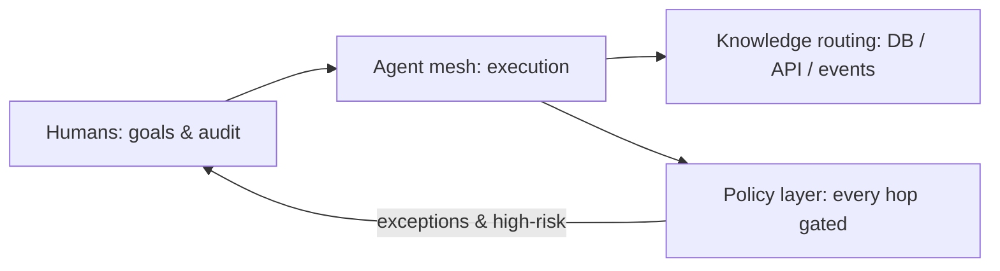

# Awesome AI-Native

**A thesis-driven map of the AI-native enterprise — what actually changes
when agents join the org chart.**

English · [简体中文](README.zh-CN.md)

🤖 **Daily arXiv radar:** [docs/radar.md](docs/radar.md) — auto-refreshed every day.

---

## The thesis

Agent capability is no longer the bottleneck — **the environment is**. Enterprise offices were designed for humans: information moves through meetings, tickets, and documents; systems assume a person at the keyboard. Agents that can work at machine speed stall at every human-shaped relay.

Manufacturing already ran this transition once, 1911–1970: from craft workshops to the assembly line to the Toyota system. The playbook transfers, with one inversion — **the assembly line standardized human *behavior*; the AI-native enterprise standardizes *interfaces and boundaries*, because an agent's value is precisely its open-ended judgment.**

Three design principles fall out, and every entry in this list serves at least one of them:

| # | Principle | One-liner |
|---|---|---|
| 1 | **Standardize interfaces, not behaviors** | SOPs die; protocols, structured context, and evals are the new screw gauges. |
| 2 | **Reduce human relay, keep human accountability** | Automate the information handoffs, never the responsibility. Every line needs an andon cord. |
| 3 | **Route knowledge, don't warehouse it** | Give agents access paths to sources of truth (DB, APIs, events) instead of one giant knowledge base. |

This is **not** a link dump. Each section states a claim, then lists the evidence.

## The manufacturing playbook (a century of prior art)

The AI-native transition is rhyming with manufacturing history. Read these before re-litigating them:

| Era | Idea | AI-native echo |
|---|---|---|
| 1911 — [Taylorism](https://en.wikipedia.org/wiki/Scientific_management) | Measure the work | Evals, observability, agent metrics |
| 1913 — [Assembly line](https://en.wikipedia.org/wiki/Assembly_line) | Standardize interfaces, decompose flow | Protocols (MCP), agent-computer interfaces |
| 1950s — [Toyota Production System](https://en.wikipedia.org/wiki/Toyota_Production_System) | Quality built in, human judgment embedded | Human-on-the-loop oversight, eval-driven management |
| [Andon cord](https://en.wikipedia.org/wiki/Andon_(manufacturing)) | Any worker can stop the line | Any human (or monitor) can halt an agent — keep this, always |

The historical lesson most people miss: pure Taylorism *failed* at quality; Toyota put human judgment back in. Expect the same pendulum — "fully automated" orgs will re-adopt human veto points once error propagation bites.

## Where organizations actually are

Signals worth reading, all primary sources:

- [When AI builds itself](https://www.anthropic.com/institute/recursive-self-improvement) — Anthropic (Jun 2026, updated Sep 2026). The most candid account from inside a frontier lab: Claude now writes most merged code and matches human-level research execution. Required reading for what "AI-native" already means at the frontier.
- [Is Recursive Self-Improvement Really Here?](https://cacm.acm.org/news/is-recursive-self-improvement-really-here/) — CACM, Logan Kugler (Jul 2026). The best skeptical companion: tactical vs. strategic recursion, the verification problem, and the sharpest framing of our era — *"the org chart problem precedes the capability problem."*
- [Measuring AI Ability to Complete Long Software Tasks](https://arxiv.org/abs/2503.14499) — METR. Task time-horizon doubling ~every 7 months: the trend line under every "when do agents take jobs" debate.
- [Who knew self-improvement could be so terrifying?](https://news.harvard.edu/gazette/story/2026/10/who-knew-self-improvement-could-be-so-terrifying/) — Harvard Gazette interview with Jonathan Zittrain (Oct 2026). When university publications start explaining RSI to alumni, the topic has left the lab.
- [TheAgentCompany](https://arxiv.org/abs/2412.14161) · [code](https://github.com/TheAgentCompany/TheAgentCompany) — the benchmark that treats a company as the test: agents must survive a simulated software firm's real workflows.
- [autoresearch](https://github.com/karpathy/autoresearch) — Karpathy (Mar 2026). The AI-native division of labor in three files: the human writes `program.md` ("research org code"), the agent writes the code. One GPU, ~100 experiments overnight, fixed 5-minute budgets.

## Agent organizations

Multi-agent systems are the lab bench for org design — roles, handoffs, management:

| Work | What it shows |
|---|---|
| [Generative Agents](https://arxiv.org/abs/2304.03442) | 25 agents in a sandboxed town; emergent social structure, memory, and coordination. The first org-scale simulacrum. |
| [MetaGPT](https://arxiv.org/abs/2308.00352) · [code](https://github.com/FoundationAgents/MetaGPT) | A software company encoded as multi-agent SOPs — and a useful caution: it encodes *human* procedures for agents, exactly what Principle 1 replaces with protocols. |
| [AutoGen](https://arxiv.org/abs/2308.08155) · [code](https://github.com/microsoft/autogen) | The general framework that made "agents talking to agents" a programming model. |
| [headcount](https://github.com/cbrock84/headcount) | An agent organization run as a real company — 15+ departments, 125+ agents. What an agent-first org chart looks like in practice. |
| [OpenHands](https://github.com/OpenHands/OpenHands) | The large open platform agents do real work on — the substrate layer of the agent firm. |
| [prime-agent](https://github.com/PrimeIntellect-ai/prime-agent) | A self-improving agent workforce for long autonomous tasks — where "agent labor" is heading. |
| [Orkas](https://github.com/Orkas-AI/Orkas) | MIT-licensed, local-first desktop AI workforce: Commander coordinates specialists from research to reports and editable slides, with supported own-provider API keys; explicit dispatch/handoff paths make roles and information handoffs inspectable (principle 2). |

## Organizational memory (the "super brain", done right)

The tempting idea: connect every employee-agent's memory into one omniscient brain that runs the company. Three fallacies to design past:

> **1. Noise pooling.** Employee memories contain contradictions, politics, and stale views; pooling raw memory amplifies noise (organizational model collapse). Aggregate with conflict detection, recency decay, and confidence — federate, don't merge.
> **2. Management ≠ inference.** Decisions create facts (budgets, hires, commitments); decision *support* automates well, decision *rights* follow accountability. Someone must own consequences.
> **3. Surveillance backlash.** Total memory access is perfect Taylorist monitoring; employees will game it (Goodhart). Access control on memory is not optional.

The research building blocks:

| Work | What it contributes |
|---|---|
| [Letta](https://github.com/letta-ai/letta) | Stateful agents with persistent memory — the memory layer organizational designs build on. |
| [reef](https://github.com/Human-Agent-Society/reef) | Infrastructure for continually self-improving agents across sessions. |
| [ACE: Agentic Context Engineering](https://arxiv.org/abs/2510.04618) | Contexts that grow their own playbooks — the *hierarchical, on-demand* alternative to omniscient context. |
| [Agent Workflow Memory](https://arxiv.org/abs/2409.07429) | Distilling successful trajectories into reusable organizational routines. |
| [Memento](https://arxiv.org/abs/2508.16153) | Agents that improve from experience without touching weights — memory as the learning substrate. |

## Skill libraries and distillation

Every employee's agent distilling their craft into shareable, versioned skills — the most practical idea in this space, and the least built:

| Work | What it contributes |
|---|---|
| [Voyager](https://arxiv.org/abs/2305.16291) | The original compounding skill library: skills as code, written and reused. |
| [Darwin Gödel Machine](https://arxiv.org/abs/2505.22954) | Agent archives: skills *and* the agents that made them, versioned for evolution. |
| [Gödel Agent](https://arxiv.org/abs/2410.04444) · [code](https://github.com/Arvid-pku/Godel_Agent) | Runtime self-modification with analysis of when it helps — the guardrails matter more than the capability. |
| [AgentEvolver](https://arxiv.org/abs/2511.10395) | Strategy / memory / tool evolution loops in one multi-agent system. |
| [distilly](https://github.com/titanwings/distilly) | Employee skill distillation, productized: feed a departing colleague's Feishu / DingTalk / Slack / WeChat trail, get back a working `.skill` for any agent — the most-watched realization of this idea so far. |
| [hermes-agent-self-evolution](https://github.com/NousResearch/hermes-agent-self-evolution) | Evolutionary skill / prompt / code optimization (DSPy + GEPA) behind hard guardrails — full test suite, size limits, human PR review. Skill CI/CD, partially built; $2–10 per run, no GPU. |

> **The open engineering problem — skill CI/CD.** Whose skill wins when two employees' distilled skills conflict? Skills need versioning, tests, review, rollback, expiry detection — a new discipline. And an org-design problem sits on top: *why would your best employee let their edge be distilled?* Without knowledge-contribution incentives, you get sandbagged skills.

## Knowledge routing (life after the knowledge base)

Knowledge-base projects grew omnipotent and organizations grew confused. The diagnosis: three query types need three different access mechanisms — no single KB product can be optimal at all three. Stop centralizing knowledge; start routing to sources of truth.

| Query type | Right mechanism | Representative work |
|---|---|---|
| "What does it say?" (text) | Retrieval / RAG | [GraphRAG](https://github.com/microsoft/graphrag) — graph-structured retrieval over messy enterprise corpora |
| "What are the numbers?" (compute) | Query execution — text2SQL, tools over the warehouse | Your existing DB + an agent with SQL access and permissions |
| "What changed?" (time-sensitive) | **Event subscription, not polling** | MCP servers pushing state; agent-friendly event streams |

| Work | What it is |
|---|---|
| [Model Context Protocol](https://github.com/modelcontextprotocol/modelcontextprotocol) | The open standard for agent↔system access — the screw gauge of the agent era (Principle 1, embodied). |

## Agent security and permissions

The sharpest unsolved problem in enterprise agents: **access paths are assembled per-task and unpredictable, yet every hop touches enterprise-grade data.** Static OA-era permission matrices cannot map that. Decompose it into three tractable sub-problems:

> **1. Identity & delegation.** Agents need their own credentials — acting on behalf of a user, a role, or themselves, with delegation chains you can audit.
> **2. Runtime authorization.** You cannot pre-whitelist exploration. Policy engines evaluate each hop at runtime; high-risk actions trigger step-up human approval (the andon cord again).
> **3. Blast-radius control.** Sandboxes must isolate sessions (no residue leaking between agents) and skills need access boundaries of their own.

| Work | What it is |
|---|---|
| [MCP specification](https://github.com/modelcontextprotocol/modelcontextprotocol) | Includes the OAuth 2.1 authorization flows agents are standardizing on. |
| [E2B](https://github.com/e2b-dev/E2B) | Secure sandboxed execution environments for agent actions — isolation as infrastructure. |
| [Cedar](https://github.com/cedar-policy/cedar) | Policy-as-code language (AWS) — the shape of runtime authorization layers agents will need. |

## Open problems

The questions this list exists to track — none solved, all load-bearing:

1. **Permission middleware for exploratory agents** — spans identity, policy, and orchestration; possibly the most valuable missing infrastructure.
2. **Skill CI/CD and knowledge-contribution incentives** — technical versioning plus organizational compensation design.
3. **Memory governance** — federation, aggregation, access control, and the surveillance line.
4. **Eval-driven management** — when agents do the work, managers grade the evals; nobody knows what that org looks like.
5. **The automation-level mosaic** — firms won't move through stages uniformly; per-function automation levels (à la Anthropic's AL0–AL5) need standardization.

## 🤖 Radar

`docs/radar.md` is regenerated **daily** by [`scripts/radar.py`](scripts/radar.py) (GitHub Actions, [workflow](.github/workflows/radar.yml)) from arXiv new-submission listings, keyword-filtered for AI-native / organizational-memory / agent-organization topics. Tune the keywords via PR.

## Related lists

- [awesome-self-improving-coding-agents](https://github.com/vicfei/awesome-self-improving-coding-agents) — the sibling list: RSI × software engineering, the technical frontier this org-level view sits on
- [IAAR-Shanghai/Awesome-AI-Memory](https://github.com/IAAR-Shanghai/Awesome-AI-Memory) — AI/LLM memory in depth
- [lobehub/awesome-rsi](https://github.com/lobehub/awesome-rsi) — the broad RSI research map
- [theseus-labs-rsi/awesome-rsi](https://github.com/theseus-labs-rsi/awesome-rsi) — RSI survey companion with an industry-practices timeline
- [ANative-Lab/Awesome-Self-Evolving-Agents](https://github.com/ANative-Lab/Awesome-Self-Evolving-Agents) — self-evolving agents survey companion
- [Picrew/awesome-rsi](https://github.com/Picrew/awesome-rsi) — research catalog including company engineering blogs

## Contributing

PRs welcome — see [CONTRIBUTING.md](CONTRIBUTING.md). The bar: primary-source links, a stated claim, and alignment with at least one of the three principles (or a well-argued rejection of one — those are the most interesting PRs).

## License

[CC0 1.0](LICENSE) — public domain.
