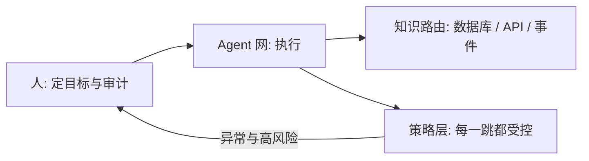

# Awesome AI-Native

**论点驱动的 AI-Native 企业地图 —— 当 Agent 进入组织架构表，到底什么在变。**

[English](README.md) · 简体中文

🤖 **每日 arXiv 雷达：** [docs/radar.md](docs/radar.md) —— 每天自动刷新。

---

## 核心论点

Agent 的能力已不是瓶颈，**环境才是**。企业办公环境为人类设计：信息靠会议、工单和文档流转，系统默认键盘前坐着一个人。能以机器速度工作的 Agent，卡死在每一个人形的接力点上。

制造业在 1911–1970 年已经走过一遍这场转型：从手工作坊到流水线再到丰田体系。这套打法可以迁移，但有一个关键反转——**流水线标准化的是人的*行为*；AI-Native 企业标准化的是*接口与边界*，因为 Agent 的价值恰恰在于它的开放式判断。**

由此得出三条设计原则，本列表的每个条目至少服务于其中一条：

| # | 原则 | 一句话 |
|---|---|---|
| 1 | **标准化接口，而非行为** | SOP 会死；协议、结构化上下文、评测集才是新的螺纹公差。 |
| 2 | **减少人工中转，保留人工问责** | 自动化的是信息交接，永远不是责任。每条产线都要有安灯绳。 |
| 3 | **路由知识，而非仓储知识** | 给 Agent 通往事实源头的路径（数据库、API、事件），而不是一个巨大的知识库。 |

这**不是**链接堆砌。每一节先立论，再列证据。

## 制造业剧本（一百年的先行实践）

AI-Native 转型正在与制造业历史押韵。重读它们，省得重新踩坑：

| 时代 | 思想 | AI-Native 对应物 |
|---|---|---|
| 1911 — [泰勒制](https://en.wikipedia.org/wiki/Scientific_management) | 度量工作本身 | 评测、可观测性、Agent 指标 |
| 1913 — [流水线](https://en.wikipedia.org/wiki/Assembly_line) | 接口标准化、流程分解 | 协议（MCP）、智能体-计算机接口 |
| 1950s — [丰田生产方式](https://en.wikipedia.org/wiki/Toyota_Production_System) | 质量内建、嵌入人的判断 | 人在环上的监督、评测驱动的管理 |
| [安灯绳](https://en.wikipedia.org/wiki/Andon_(manufacturing)) | 任何工人都可以拉停产线 | 任何人类（或监控器）都可以叫停 Agent——永远保留 |

最常被错过的历史教训：纯泰勒制在质量面前*失败*了，丰田把人的判断放回了产线。预期同样的摆动——"全自动"组织会在错误传播开始咬人之后，重新引入人类否决点。

## 组织当前真实所处的位置

值得一读的信号，全部是一手来源：

- [When AI builds itself](https://www.anthropic.com/institute/recursive-self-improvement) —— Anthropic（2026 年 6 月，9 月更新）。前沿实验室内部最坦诚的叙述：Claude 已写下大部分合并代码，研究执行达到人类水平。理解 AI-Native 在前沿意味着什么的首选读物。
- [Is Recursive Self-Improvement Really Here?](https://cacm.acm.org/news/is-recursive-self-improvement-really-here/) —— CACM，Logan Kugler（2026 年 7 月）。最好的怀疑论伴读：战术递归 vs 战略递归、验证难题，以及本时代最锋利的表述——*"组织架构问题先于能力问题。"*
- [Measuring AI Ability to Complete Long Software Tasks](https://arxiv.org/abs/2503.14499) —— METR。任务时间视野约每 7 个月翻倍：一切"Agent 何时胜任岗位"争论之下的趋势线。
- [Who knew self-improvement could be so terrifying?](https://news.harvard.edu/gazette/story/2026/10/who-knew-self-improvement-could-be-so-terrifying/) —— Harvard Gazette 对 Jonathan Zittrain 的访谈（2026 年 10 月）。当大学校刊开始向校友解释 RSI，这个话题已经走出实验室。
- [TheAgentCompany](https://arxiv.org/abs/2412.14161) · [代码](https://github.com/TheAgentCompany/TheAgentCompany) —— 把公司当考场的基准：Agent 必须在模拟软件公司的真实工作流里存活。
- [autoresearch](https://github.com/karpathy/autoresearch) —— Karpathy（2026 年 3 月）。三个文件写尽 AI-Native 分工：人写 `program.md`（"科研组织代码"），agent 写代码。一张 GPU、一晚约 100 个实验、固定 5 分钟预算。

## Agent 组织

多智能体系统是组织设计的实验台——角色、交接、管理：

| 工作 | 展示了什么 |
|---|---|
| [Generative Agents](https://arxiv.org/abs/2304.03442) | 沙盒小镇里的 25 个智能体；涌现出社会结构、记忆与协调。第一个组织尺度的社会模拟。 |
| [MetaGPT](https://arxiv.org/abs/2308.00352) · [代码](https://github.com/FoundationAgents/MetaGPT) | 把软件公司编码为多智能体 SOP——同时也是一记警钟：它把*人的*流程喂给 Agent，恰是原则 1 要用协议替换掉的东西。 |
| [AutoGen](https://arxiv.org/abs/2308.08155) · [代码](https://github.com/microsoft/autogen) | 让"Agent 与 Agent 对话"成为编程模型的通用框架。 |
| [headcount](https://github.com/cbrock84/headcount) | 按真实公司结构运营的 Agent 组织——15+ 部门、125+ 个 Agent。Agent 优先的组织架构表长什么样。 |
| [OpenHands](https://github.com/OpenHands/OpenHands) | Agent 干真活的大型开源平台——Agent 企业的底座层。 |
| [prime-agent](https://github.com/PrimeIntellect-ai/prime-agent) | 面向长时自治任务的自改进 Agent 劳动力——"Agent 劳动"的去向。 |
| [Orkas](https://github.com/Orkas-AI/Orkas) | MIT 许可、本地优先的桌面 AI 团队：Commander 协调专业 Agent，将研究衔接为报告与可编辑幻灯片，并支持自有模型服务商与 API Key；明确的派发与交接路径让角色分工和信息交接可供检查（原则 2）。 |

## 组织记忆（做对的"超级大脑"）

那个诱人的想法：把每个员工 Agent 的记忆连成一个全知大脑来经营公司。要先绕过三个谬误：

> **1. 噪声汇聚。** 员工记忆里满是矛盾、政治与过时判断；原始池化放大的是噪声（组织级模型坍缩）。要聚合而非合并：冲突检测、时效衰减、置信度标注——联邦化，不打通。
> **2. 管理 ≠ 推理。** 决策制造事实（预算、招聘、承诺）；决策*支持*可以自动化，决策*权*跟着问责走。总得有人承担后果。
> **3. 监控反弹。** 记忆全通 = 完美的泰勒制监控；员工会用脚投票（Goodhart 定律）。记忆的访问控制不是可选项。

研究积木：

| 工作 | 贡献了什么 |
|---|---|
| [Letta](https://github.com/letta-ai/letta) | 有持久记忆的有状态智能体——组织设计所依赖的记忆层。 |
| [reef](https://github.com/Human-Agent-Society/reef) | 跨会话持续自改进智能体的基础设施。 |
| [ACE: Agentic Context Engineering](https://arxiv.org/abs/2510.04618) | 会自我生长的上下文——全知上下文的替代方案：层级式、按需投喂。 |
| [Agent Workflow Memory](https://arxiv.org/abs/2409.07429) | 把成功轨迹蒸馏为可复用的组织例程。 |
| [Memento](https://arxiv.org/abs/2508.16153) | 不动权重、从经验中学习的智能体——记忆即学习基质。 |

## 技能库与蒸馏

每个员工的 Agent 把其手艺蒸馏为可共享、可版本化的技能——本领域最务实、也最少被建成的想法：

| 工作 | 贡献了什么 |
|---|---|
| [Voyager](https://arxiv.org/abs/2305.16291) | 最初的复利式技能库：技能即代码，边写边复用。 |
| [Darwin Gödel Machine](https://arxiv.org/abs/2505.22954) | 智能体档案：连同制造它们的智能体一起版本化，供进化取用。 |
| [Gödel Agent](https://arxiv.org/abs/2410.04444) · [代码](https://github.com/Arvid-pku/Godel_Agent) | 运行时自我修改及其何时有效的分析——护栏比能力更重要。 |
| [AgentEvolver](https://arxiv.org/abs/2511.10395) | 策略/记忆/工具三种进化循环合一的多智能体系统。 |
| [distilly](https://github.com/titanwings/distilly) | 员工技能蒸馏的产品化：输入离职同事的飞书/钉钉/Slack/微信痕迹，产出任何 agent 可用的 `.skill`——迄今该想法最受关注的落地。 |
| [hermes-agent-self-evolution](https://github.com/NousResearch/hermes-agent-self-evolution) | 进化式技能/提示词/代码优化（DSPy + GEPA），套着硬护栏——全量测试、尺寸限制、人工 PR 审核。技能 CI/CD 的半成品；单次 $2–10，无需 GPU。 |

> **悬而未决的工程问题——技能 CI/CD。** 两个员工蒸馏出的技能冲突时，谁的上？技能需要版本、测试、评审、回滚、失效检测——一个新工种。上面还压着一个组织设计问题：*你最好的员工凭什么让自己的独门手艺被蒸馏？* 没有知识贡献激励，得到的就是留一手的技能。

## 知识路由（知识库之后的人生）

知识库项目无所不能了，组织却更迷茫了。诊断：三类查询需要三种不同的访问机制——没有任何单一知识库产品能同时对三者最优。停止把知识集中仓储；开始向事实源头路由。

| 查询类型 | 正确机制 | 代表工作 |
|---|---|---|
| "上面写了什么？"（文字） | 检索 / RAG | [GraphRAG](https://github.com/microsoft/graphrag) —— 对混乱企业语料的图结构检索 |
| "数字是多少？"（计算） | 查询执行——text2SQL、数据仓库上的工具 | 现有数据库 + 一个有 SQL 权限的 Agent |
| "有什么变化？"（时间敏感） | **事件订阅，而非轮询** | 推送状态的 MCP 服务；Agent 友好的事件流 |

| 工作 | 是什么 |
|---|---|
| [Model Context Protocol](https://github.com/modelcontextprotocol/modelcontextprotocol) | Agent↔系统访问的开放标准——Agent 时代的螺纹公差（原则 1 的具象化）。 |

## Agent 安全与权限

企业 Agent 领域最锐利的未解难题：**访问路径按任务临时组装、不可预测，而每一跳都触碰企业级数据。** OA 时代的静态权限矩阵映射不了它。拆成三个可解的子问题：

> **1. 身份与委托。** Agent 需要自己的凭证——代表用户、角色或自身行事，委托链可审计。
> **2. 运行时授权。** 探索无法预白名单。策略引擎在运行时评估每一跳；高风险动作触发人工升权批准（又是安灯绳）。
> **3. 爆炸半径控制。** 沙盒必须隔离会话（Agent 之间无残留泄漏），技能也需要自己的访问边界。

| 工作 | 是什么 |
|---|---|
| [MCP 规范](https://github.com/modelcontextprotocol/modelcontextprotocol) | 含 Agent 正在标准化的 OAuth 2.1 授权流。 |
| [E2B](https://github.com/e2b-dev/E2B) | 面向 Agent 动作的安全沙盒执行环境——隔离即基础设施。 |
| [Cedar](https://github.com/cedar-policy/cedar) | 策略即代码语言（AWS）——Agent 所需运行时授权层的形状。 |

## 悬而未决的问题

本列表存在的意义就是追踪这些问题——都未解决，都承重：

1. **面向探索式 Agent 的权限中间件**——横跨身份、策略与编排；可能是最有价值的缺失基础设施。
2. **技能 CI/CD 与知识贡献激励**——技术上的版本化 + 组织上的补偿设计。
3. **记忆治理**——联邦化、聚合、访问控制，以及监控的红线。
4. **评测驱动的管理**——Agent 干活、管理者给评测打分时，组织长什么样没人知道。
5. **自动化等级马赛克**——企业不会整体分阶段迁移；按职能的自动化等级（参照 Anthropic 的 AL0–AL5）需要标准化。

## 🤖 雷达

`docs/radar.md` 由 [`scripts/radar.py`](scripts/radar.py)（GitHub Actions，[workflow](.github/workflows/radar.yml)）基于 arXiv 新提交列表**每天**重建，按 AI-Native / 组织记忆 / Agent 组织主题做关键词过滤。欢迎提 PR 调整关键词。

## 相邻列表

- [awesome-self-improving-coding-agents](https://github.com/vicfei/awesome-self-improving-coding-agents) —— 姊妹列表：RSI × 软件工程，本组织级视图所依托的技术前沿
- [IAAR-Shanghai/Awesome-AI-Memory](https://github.com/IAAR-Shanghai/Awesome-AI-Memory) —— AI/LLM 记忆专题
- [lobehub/awesome-rsi](https://github.com/lobehub/awesome-rsi) —— 覆盖最广的 RSI 研究地图
- [theseus-labs-rsi/awesome-rsi](https://github.com/theseus-labs-rsi/awesome-rsi) —— RSI 综述配套，含产业实践时间线
- [ANative-Lab/Awesome-Self-Evolving-Agents](https://github.com/ANative-Lab/Awesome-Self-Evolving-Agents) —— 自进化智能体综述配套
- [Picrew/awesome-rsi](https://github.com/Picrew/awesome-rsi) —— 含各公司工程博客的研究目录

## 贡献

欢迎 PR —— 见 [CONTRIBUTING.md](CONTRIBUTING.md)。门槛：一手来源链接、明确的论点、对齐三条原则中至少一条（或有理有据地反对某一条——那是最有趣的 PR）。

## 许可

[CC0 1.0](LICENSE) —— 公共领域。
